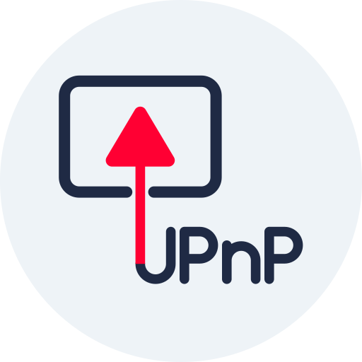

<div align="center">
  
</div>

# DialUP for Android

An Android app that acts as a bridge between UPnP/DLNA media renderers and Casting. It finds UPnP/DLNA
renderers on the Wi-Fi network, emulates each one as a modern cast target in the actual YouTube and YouTube Music apps (DIAL), resolves
audio with yt-dlp, remuxes or transcodes with ffmpeg, and serves the stream to the renderer.

**This project currently casts audio-only! Video capabilities are planned as a possible future upgrade**

## Requirements

- Android 8.0 (API 26) or newer
- UPnP/DLNA renderer(s)
- YouTube/YouTube Music apps for casting


## Features

- **Gapless track changes**: Helps ensure a seamless transition between tracks without an noticable wait. on by default, for renderers that support it.
- **Caching** (Cached mode): renderer-ready audio files are cached locally so they aren't downloaded with yt-dlp again. Newly downloaded sources are temporary and removed when no longer in use; sources retained by older versions can be removed with "Clear cache". Oldest entries are purged automatically to make space, and tracks too big for the cache aren't kept. Android's "Clear cache" also empties it
- **Playback modes**: Streaming, Direct or Cached, chosen in Settings; see [Playback modes](#playback-modes) below.
- **Audio format display**: Optionally show the format currently loaded on each renderer's card. It updates if playback falls back to another format.
- **Hidden renderers**: Renderers can be hidden and will be removed as DIAL targets from the cast menu. Useful for TVs or other devices you don't want listed
- **Full casting control**: Native casting control from YouTube and YouTube Music, including seeking, synced buffering, volume controls, next/previous track controls, autoplay, shuffle, repeat, and track metadata
- **Wi-Fi recovery**: Brief Wi-Fi drops don't interrupt the cast; the bridge resyncs when Wi-Fi returns

## Playback modes

| | Streaming (default) | Direct | Cached |
|---|---|---|---|
| What the phone does | Fetches the audio and passes it on as a live stream (AAC copied as-is; re-encoded to MP3 only if the speaker rejects AAC) | Passes the original audio on unchanged, with no FFmpeg | Downloads the whole track, remuxes it to an MP4 file, then serves the file |
| Start of playback | Fast | Fast | Slower: the whole track is fetched first |
| Skipping within a track | Reloads the stream at the new position (a short pause) | Left to the speaker, which can be very slow on long tracks | The speaker seeks within the file, normally the smoothest |
| Phone battery and CPU | Low with AAC; higher if it falls back to MP3 | Lowest | Busy while downloading, then low |
| Phone storage | None | None | Uses the cache (256 MB by default, set in Settings) |
| Speaker support | Falls back to MP3 if the speaker rejects AAC | Speaker must support the original audio format | Speaker plays a finished file, not a live stream |

## Privacy

- No account, no server of its own and no analytics. Everything runs locally.
- A Google account is not required and is never connected. DialUP does not sign in to anything: yt-dlp looks up the
  audio anonymously, and the phone sends the speaker only a link to its own address on your network.

<div style="display: flex; gap: 16px; align-items: center;">
  
  
  
</div>

## Build from source

Needs JDK 21, the Android SDK (platform 37, build-tools 36.0.0) and Gradle via the wrapper.
`tools/bootstrap-toolchain.sh` installs the toolchain in user space.

```
./gradlew test                 # JVM unit tests
./gradlew :app:assembleDebug
./gradlew :app:assembleRelease # unsigned unless signing material is provided (see keystore.properties.example)
```

| Module | Job |
|--------|-----|
| `upnp` | SSDP, SOAP control, device descriptions |
| `dial` | DIAL server and SSDP responder, one per speaker |
| `lounge` | YouTube lounge receiver and InnerTube client |
| `media` | Local media server (Range, pipe, file cache) |
| `renderer` | Per-speaker playback logic, queue, gapless hand-off |
| `app` | Android service, config, yt-dlp / ffmpeg wiring |

`tools/` holds helper scripts for on-device testing (adb, fake speaker, log reports).

## Credits

DialUP is a Kotlin port of [Tube2U[PnP]](https://github.com/deaksa/tube2upnp) by deaksa and contributors, a fork of
[upnpTube](https://github.com/mas94uk/upnpTube) by [Mark Smith](https://github.com/mas94uk). Its YouTube lounge and DIAL
logic come from [yt-cast-receiver](https://github.com/patrickkfkan/yt-cast-receiver) and
[peer-dial](https://github.com/patrickkfkan/peer-dial) by [Patrick Kan](https://github.com/patrickkfkan)
(peer-dial originally by Louay Bassbouss, Fraunhofer FOKUS). Audio lookup uses [yt-dlp](https://github.com/yt-dlp/yt-dlp).
Thanks to everyone involved. Full attributions and licences are in `THIRD_PARTY_NOTICES.md`.

## Licence

GPL-3.0-only, see `LICENSE`. Third-party components are listed in `THIRD_PARTY_NOTICES.md`.

DialUP is based on [Tube2U[PnP]](https://github.com/deaksa/tube2upnp) / [upnpTube](https://github.com/mas94uk/upnpTube) (GPL-3.0-only), so it is released under the same licence.
The APK also bundles GPL-covered binaries (FFmpeg and ffprobe from the Termux build, and the youtubedl-android
modules) together with CPython, QuickJS and yt-dlp.

### Source offer

- The source of DialUP is this repository; every release is tagged, and the tag matches the APK.
- The source of the bundled binaries is linked, pinned to the exact versions, in `THIRD_PARTY_NOTICES.md`
  (youtubedl-android tag `0.18.1`, FFmpeg 7.1.1, the Termux ffmpeg build recipe at commit `c7585599a9`).
- If a link is unavailable, open an issue and the complete corresponding source will be provided.
