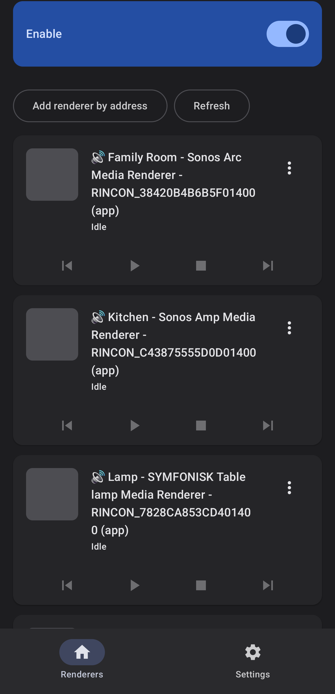
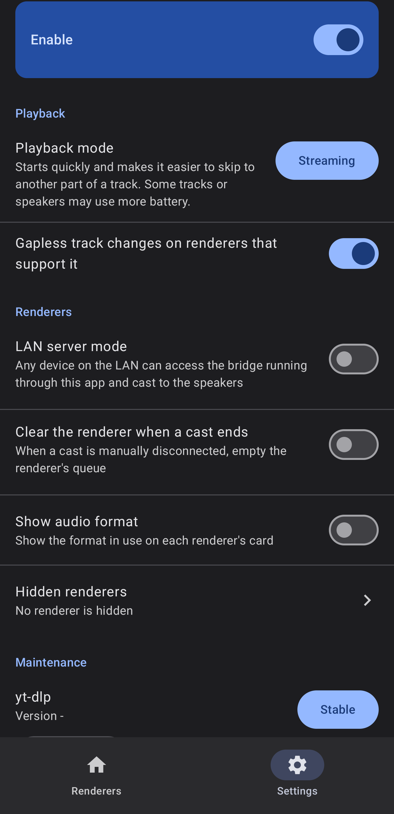
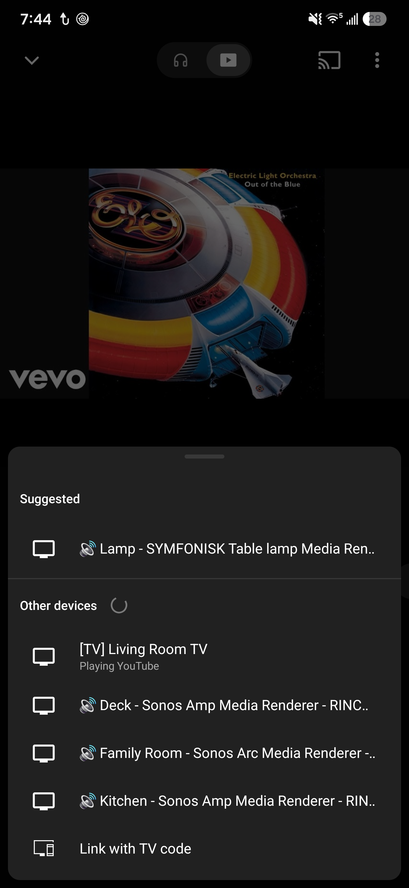

# DialUP for Android

A native Kotlin Android app (application ID `dev.dialup`) that makes the phone the whole cast bridge. It finds UPnP/DLNA
speakers on the Wi-Fi network, shows each one as a cast target in the YouTube and YouTube Music apps (DIAL), resolves
audio with yt-dlp, remuxes or transcodes with ffmpeg, and serves the stream to the speaker. No always-on server is needed.

DialUP is based on [Tube2U[PnP]](https://github.com/deaksa/tube2upnp), a Node.js project (itself a fork of upnpTube),
and is released under the same licence.

## Requirements

- An Android 8.0 (API 26) or newer phone
- UPnP/DLNA speakers (network renderers that accept a stream from a control app).
- YouTube/YouTube Music apps for casting.


## Features

- **LAN access**: off by default, which means only the phone's own apps can reach the bridge. Switch it on to let any
  device on the LAN access the bridge and cast to the speakers.
- **Clear the renderer when a cast ends**: off by default; when on, the renderer's queue is emptied when a cast ends.
- **Gapless track changes**: on by default, for renderers that support it. Helps ensure a seamless transition between tracks without an noticable wait
- **Caching**: audio files are cached locally for future playback without needing to be downloaded with yt-dlp again. The oldest entries are purged automatically to make space for new tracks
- **Forced audio format**: Automatic by default; Direct, MP4, AAC stream (adts), FLAC and MP3 can be forced. Automatic will play in the highest quality audio format a given renderer supports natively
- **Hidden renderers**: Renderers can be hidden and will be removed as DIAL targets from the cast menu. Useful for TVs or other devices you don't want listed
- **utomatic update checking**: when the app is opened it checks GitHub for a newer DialUP release, at most twice a day, and shows a
  card with a link to the release page on the Renderers tab

## Privacy

- No account, no server of its own and no analytics. Everything runs locally.
- A Google account is not required and is never connected. DialUP does not sign in to anything: yt-dlp looks up the
  audio anonymously, and the phone sends the speaker only a link to its own address on your network.

## Screenshots

| Renderers | Settings | Cast menu |
|-----------|----------|-----------|
|  |  |  |

## Build from source

Needs JDK 21, the Android SDK (platform 37, build-tools 36.0.0) and Gradle via the wrapper.
`tools/bootstrap-toolchain.sh` installs the toolchain in user space.

```
./gradlew test                 # JVM unit tests
./gradlew :app:assembleDebug
./gradlew :app:assembleRelease # unsigned unless signing material is provided (see keystore.properties.example)
```

| Module | Job |
|--------|-----|
| `upnp` | SSDP, SOAP control, device descriptions |
| `dial` | DIAL server and SSDP responder, one per speaker |
| `lounge` | YouTube lounge receiver and InnerTube client |
| `media` | Local media server (Range, pipe, file cache) |
| `renderer` | Per-speaker playback logic, queue, gapless hand-off |
| `app` | Android service, config, yt-dlp / ffmpeg wiring |

`tools/` holds helper scripts for on-device testing (adb, fake speaker, log reports).

## Licence

GPL-3.0-only, see `LICENSE`. Third-party components are listed in `THIRD_PARTY_NOTICES.md`.

DialUP is based on Tube2U[PnP] / upnpTube (GPL-3.0-only), so it is released under the same licence.
The APK also bundles GPL-covered binaries (FFmpeg and ffprobe from the Termux build, and the youtubedl-android
modules) together with CPython, QuickJS and yt-dlp.
